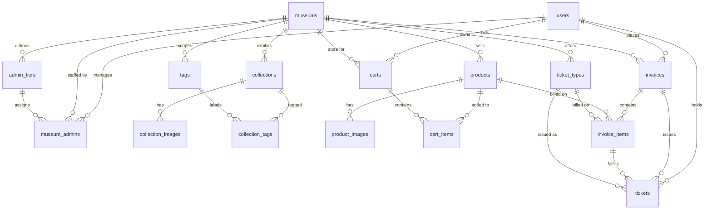

# Database Design

This document is the source of truth for the persisted data model of the museum
platform. It is written so a coding agent can turn it directly into Drizzle
schemas and migrations without guessing at intent.

**Status:** implemented in `src/db/schemas/` with Drizzle migrations in `drizzle/`.
This document describes the intended persisted model and its database-enforced
integrity rules; service-layer authorization and business rules are called out
separately.

---

## 1. Mental model

The platform is a **multi-tenant storefront for museums**. One museum = one store:

```
Museum 1 ──* Collections (public catalogue: items, images, tags)
        ├──1 Merchandise shop   (optional, gated by museums.shop_enabled)
        └──1 Ticket sales       (optional, gated by museums.tickets_enabled)
```

- A **user** is one Supabase Auth account per email and can use both the public website and the Admin Dashboard. Public-site access is available to any authenticated user; dashboard access requires a `museum_admins` membership row (membership has no separate active-state column).
- **Admins** belong to museums (`museum_admins`) and carry a museum-defined
  **tier** (e.g. *Project organizer*, *Volunteer*, *Founder*).
- A museum is owned by **one or more admins** (`is_owner = true`).
- **Collections** are the public exhibition catalogue (name, tags, images, ...).
- **Merchandise** is a small e-commerce flow: product catalogue → cart → invoice.
- **Tickets** are admin-configurable admission products. Each purchase issues one
  `tickets` row per admission with a unique QR code.

### Identity decision

Authentication is managed exclusively by **Supabase Auth** in a single Supabase
project. Supabase Auth owns signup, signin, password hashing, password reset,
email verification, and JWT issuance through `auth.users`. This backend does not
store passwords or handle password operations; it verifies Supabase access tokens
from the `Authorization: Bearer <token>` header. Supabase Storage remains the
object storage for images.

---

## 2. Conventions

Apply these to every table.

| Concern | Decision |
| --- | --- |
| Primary keys | `uuid`, generated by the database (`gen_random_uuid()`), column `id` |
| Naming | Tables/columns in `snake_case`; Drizzle properties in `camelCase` (`museumId: uuid('museum_id')`) |
| Timestamps | `created_at timestamptz NOT NULL DEFAULT now()`, `updated_at timestamptz NOT NULL DEFAULT now()` on all mutable tables |
| Money | Integer minor units (`bigint`), never floats. `currency` is a `char(3)` ISO-4217 code on `museums` and is **snapshotted** onto invoices, invoice items, and issued tickets. Services must apply the currency's ISO-4217 minor-unit exponent (including zero-decimal JPY and three-decimal currencies); reject unsupported codes and avoid assuming every currency has two decimals |
| Email | Stored lowercase and trimmed; `users.email` is `UNIQUE` |
| Public URLs | Human-readable `slug`, unique per scope (`museums.slug` globally, `products.slug` / `tags.slug` per museum) |
| Deletion | No soft-delete columns. Use a `status` enum (`draft`/`active`/`archived`) to retire rows. Financial records (`invoices`) are never deleted |
| Tenancy | Every business row is reachable from a `museum_id`. **Every service query must filter by the authenticated museum** — never trust an id alone (IDOR protection) |
| Files | Only the storage **path/key** is stored in Postgres (`*_images.storage_path`). Binaries live in a Supabase Storage bucket and are served via signed/public URLs |

Schema files: one file per aggregate under `src/db/schemas/`
(`museums.ts`, `collections.ts`, `commerce.ts`, `tickets.ts`, `auth.ts` ...),
re-exported from `src/db/schemas/index.ts`.

---

## 3. Entity overview



---

## 4. Identity & access

### `users`
Application profile row for one human account. Its `id` maps 1:1 to the account
UUID in Supabase Auth's `auth.users`; authentication credentials and verification
state are managed by Supabase Auth, not stored here. Provision the profile idempotently
from a trusted Auth signup event or first authenticated request, and reconcile failed
provisioning. Auth account deletion must remove the profile only when no retained
invoice/ticket history references it; otherwise retain a privacy-minimized profile
or use a documented anonymization policy so `RESTRICT` history remains valid.

| Column | Type | Constraints / notes |
| --- | --- | --- |
| `id` | uuid | PK, same UUID as `auth.users.id` |
| `email` | text | NOT NULL, UNIQUE, lowercased |
| `display_name` | text | NOT NULL |
| `phone` | text | NULL |
| `avatar_url` | text | NULL |
| `created_at` / `updated_at` | timestamptz | NOT NULL |

The `users` table lives in the `public` schema. Public storefront features are
available to any authenticated account. Admin Dashboard access is denied with
`403 Forbidden` unless the authenticated user has a `museum_admins` row for the
requested museum. Museum-level capabilities and permissions are represented by
`museum_admins` and `admin_tiers`.

### `admin_tiers`
Admin tiers are **defined per museum** so the founder can customize them
(seeded with *Project organizer*, *Volunteer*, *Founder*).

| Column | Type | Constraints / notes |
| --- | --- | --- |
| `id` | uuid | PK; UNIQUE (`id`, `museum_id`) for composite scope references |
| `museum_id` | uuid | FK → `museums.id` ON DELETE CASCADE |
| `name` | text | NOT NULL, UNIQUE (`museum_id`, `name`) |
| `permissions` | jsonb | NOT NULL DEFAULT `'{}'` — reserved for fine-grained checks (TBD) |
| `created_at` / `updated_at` | timestamptz | NOT NULL |

### `museum_admins`
Membership of an admin in a museum, plus their tier.

| Column | Type | Constraints / notes |
| --- | --- | --- |
| `id` | uuid | PK |
| `museum_id` | uuid | FK → `museums.id` ON DELETE CASCADE |
| `user_id` | uuid | FK → `users.id` ON DELETE CASCADE |
| `tier_id` | uuid | Composite FK (`tier_id`, `museum_id`) → `admin_tiers(id, museum_id)` ON DELETE SET NULL, NULL allowed; a membership can only use a tier defined by the same museum |
| `is_owner` | boolean | NOT NULL DEFAULT false. Co-ownership is allowed; a museum must always keep ≥ 1 owner (enforced in the service layer) |
| `created_at` | timestamptz | NOT NULL |
| *(UNIQUE)* | | (`museum_id`, `user_id`) |

---

## 5. Museums

### `museums`
The tenant and the storefront.

| Column | Type | Constraints / notes |
| --- | --- | --- |
| `id` | uuid | PK |
| `slug` | text | NOT NULL, UNIQUE, URL-safe |
| `name` | text | NOT NULL |
| `description` | text | NULL |
| `address` | text | NULL |
| `latitude` / `longitude` | numeric(9,6) | NULL |
| `cover_image_path` | text | NULL, Supabase Storage key |
| `currency` | char(3) | NOT NULL DEFAULT `'USD'` — single currency per museum |
| `visibility_status` | `museum_visibility_status` enum | NOT NULL DEFAULT `draft`; `published` museums may appear in public listings, `draft`/`archived` are not public |
| `shop_enabled` | boolean | NOT NULL DEFAULT false |
| `tickets_enabled` | boolean | NOT NULL DEFAULT false |
| `created_at` / `updated_at` | timestamptz | NOT NULL |

The public museum listing includes only museums with `visibility_status = 'published'`.
Public collection/catalog reads also require the parent museum to be published, in
addition to the collection's own publication status. Feature flags are
**authoritative**: every shop/ticket service must reject
requests when the corresponding flag is `false`, regardless of what rows exist.

---

## 6. Collections (public catalogue)

### `collections`

| Column | Type | Constraints / notes |
| --- | --- | --- |
| `id` | uuid | PK |
| `museum_id` | uuid | FK → `museums.id` ON DELETE CASCADE |
| `title` | text | NOT NULL |
| `slug` | text | NOT NULL, UNIQUE (`museum_id`, `slug`) |
| `description` | text | NULL |
| `status` | `content_status` enum | NOT NULL DEFAULT `draft` |
| `created_at` / `updated_at` | timestamptz | NOT NULL |

Index: `(museum_id, status)` for public listing.

### `collection_images`

| Column | Type | Constraints / notes |
| --- | --- | --- |
| `id` | uuid | PK |
| `collection_id` | uuid | FK → `collections.id` ON DELETE CASCADE |
| `storage_path` | text | NOT NULL (Supabase Storage key) |
| `alt_text` | text | NULL |
| `position` | integer | NOT NULL DEFAULT 0, ordering |
| `created_at` | timestamptz | NOT NULL |

### `tags` / `collection_tags`
Tags are museum-scoped so different museums can use the same label independently.

| Table | Columns |
| --- | --- |
| `tags` | `id` uuid PK, `museum_id` FK → museums, `name` text NOT NULL, `slug` text NOT NULL, `created_at`; UNIQUE (`id`, `museum_id`) and UNIQUE (`museum_id`, `slug`) |
| `collection_tags` | `collection_id`, `tag_id`, `museum_id`; PK (`collection_id`, `tag_id`); composite FKs (`collection_id`, `museum_id`) → `collections(id, museum_id)` and (`tag_id`, `museum_id`) → `tags(id, museum_id)`, both ON DELETE CASCADE |

The shared `museum_id` is a database-enforced scope key: a collection cannot be
associated with a tag owned by another museum. `collections` likewise has UNIQUE
(`id`, `museum_id`) to support the composite FK.

---

## 7. Merchandise shop

Only usable when `museums.shop_enabled = true`.

### `products`

| Column | Type | Constraints / notes |
| --- | --- | --- |
| `id` | uuid | PK |
| `museum_id` | uuid | FK → `museums.id` ON DELETE CASCADE |
| `name` | text | NOT NULL |
| `slug` | text | NOT NULL, UNIQUE (`museum_id`, `slug`) |
| `description` | text | NULL |
| `price_minor` | bigint | NOT NULL, CHECK `>= 0`; amount in the museum currency's ISO-4217 minor units |
| `stock_quantity` | integer | NOT NULL DEFAULT 0, CHECK `>= 0` |
| `status` | `content_status` enum | NOT NULL DEFAULT `draft` |
| `created_at` / `updated_at` | timestamptz | NOT NULL |

Index: `(museum_id, status)` for the public shop listing.
Stock is decremented at payment time inside the same transaction that creates
the invoice (see §8) — never allow stock below zero.

### `product_images`
Same shape as `collection_images`, with `product_id` instead of `collection_id`.

### `carts`
One cart per `(user, museum)` pair. Carts exist only for merchandise.

| Column | Type | Constraints / notes |
| --- | --- | --- |
| `id` | uuid | PK |
| `user_id` | uuid | FK → `users.id` ON DELETE CASCADE |
| `museum_id` | uuid | FK → `museums.id` ON DELETE CASCADE |
| `created_at` / `updated_at` | timestamptz | NOT NULL |
| *(UNIQUE)* | | (`user_id`, `museum_id`) |

### `cart_items`

| Column | Type | Constraints / notes |
| --- | --- | --- |
| `id` | uuid | PK |
| `cart_id` | uuid | Part of composite FK (`cart_id`, `museum_id`) → `carts(id, museum_id)` ON DELETE CASCADE |
| `product_id` | uuid | Part of composite FK (`product_id`, `museum_id`) → `products(id, museum_id)` ON DELETE CASCADE; cart contents are ephemeral |
| `museum_id` | uuid | Required scope key shared by both composite FKs; prevents cross-museum cart/product links |
| `quantity` | integer | NOT NULL, CHECK `>= 1` |
| `created_at` | timestamptz | NOT NULL |
| *(UNIQUE)* | | (`cart_id`, `product_id`) |

A cart item is a *reference*, not a price snapshot — price is resolved at checkout.

---

## 8. Invoices (shared checkout record)

Invoices are the immutable billing record for **both** merchandise and tickets.
They are what the purchase history queries read. Tenant deletion is intentionally
blocked by retained invoices/tickets (`RESTRICT`); museums with financial history
must be archived, not hard-deleted. The listed tenant cascades apply only when no
retained financial references exist (or under a separately approved retention purge).

### `invoices`

| Column | Type | Constraints / notes |
| --- | --- | --- |
| `id` | uuid | PK |
| `user_id` | uuid | FK → `users.id` ON DELETE RESTRICT |
| `museum_id` | uuid | FK → `museums.id` ON DELETE RESTRICT |
| `kind` | `invoice_kind` enum | `merchandise` \| `ticket` |
| `status` | `invoice_status` enum | NOT NULL DEFAULT `pending` |
| `subtotal_minor` | bigint | NOT NULL, CHECK `>= 0`; snapshot amount in currency minor units |
| `total_minor` | bigint | NOT NULL, CHECK `>= 0`; snapshot amount in currency minor units |
| `currency` | char(3) | NOT NULL, snapshot of `museums.currency` |
| `billing_email` | text | NOT NULL, normalized contact snapshot used for the order |
| `billing_name` | text | NOT NULL, contact snapshot used for the order |
| `shipping_name` | text | NULL; required for merchandise invoices when physical delivery is supported |
| `shipping_phone` | text | NULL |
| `shipping_address` | jsonb | NULL; immutable address snapshot for merchandise fulfillment |
| `created_at` | timestamptz | NOT NULL |
| `paid_at` | timestamptz | NULL |

Index: `(user_id, created_at DESC)` for "my invoices" history.

### `invoice_items`
One row per line. Exactly one of `product_id` / `ticket_type_id` is set. For a ticket line, the row's `quantity` is the number of admissions issued; create exactly that many `tickets` rows and link each ticket to this line with `invoice_item_id`. For merchandise, no ticket rows are created.

| Column | Type | Constraints / notes |
| --- | --- | --- |
| `id` | uuid | PK |
| `invoice_id` | uuid | Part of composite FK (`invoice_id`, `museum_id`, `user_id`, `invoice_kind`) → `invoices(id, museum_id, user_id, kind)` ON DELETE CASCADE |
| `museum_id` / `user_id` | uuid | Required scope keys; must match the parent invoice |
| `invoice_kind` | `invoice_kind` enum | Required; must match the parent invoice and target type |
| `product_id` | uuid | Nullable, composite FK (`product_id`, `museum_id`) → `products(id, museum_id)` ON DELETE RESTRICT |
| `ticket_type_id` | uuid | Nullable, composite FK (`ticket_type_id`, `museum_id`) → `ticket_types(id, museum_id)` ON DELETE RESTRICT |
| `description` | text | NOT NULL — snapshot of the product/type name at purchase |
| `unit_price_minor` | bigint | NOT NULL, CHECK `>= 0`; currency minor units |
| `quantity` | integer | NOT NULL, CHECK `>= 1` |
| *(CHECK)* | | `num_nonnulls(product_id, ticket_type_id) = 1` |

---

## 9. Tickets

Two tables with different jobs — do not merge them:

- **`ticket_types`** — what an **admin defines and customizes** (the product / template).
- **`tickets`** — what a **buyer receives**: one row per admission with its own QR code.

### `ticket_types`
Customization lives here as nullable columns + CHECK constraints, never as separate
tables per mode. This is the table the Admin Dashboard edits.

| Column | Type | Constraints / notes |
| --- | --- | --- |
| `id` | uuid | PK |
| `museum_id` | uuid | FK → `museums.id` ON DELETE CASCADE |
| `name` | text | NOT NULL |
| `description` | text | NULL |
| `price_minor` | bigint | NOT NULL, CHECK `>= 0`; amount in the museum currency's ISO-4217 minor units |
| `date_mode` | `ticket_date_mode` enum | NOT NULL DEFAULT `open` — `open` is valid for any date selected at checkout; `fixed` is valid only on `valid_date` |
| `valid_date` | date | NULL — NOT NULL when `date_mode = 'fixed'`; ignored for `open` |
| `time_mode` | `ticket_time_mode` enum | NOT NULL DEFAULT `all_day` — `all_day` or `slot` |
| `slot_start_time` | time | NULL — NOT NULL when `time_mode = 'slot'` |
| `slot_end_time` | time | NULL — NOT NULL when `time_mode = 'slot'`, must be `>` `slot_start_time` |
| `capacity` | integer | NULL = unlimited. Applies per valid date/visit |
| `sales_start_at` / `sales_end_at` | timestamptz | NULL = no window |
| `is_active` | boolean | NOT NULL DEFAULT true (admin pause switch) |
| `created_at` / `updated_at` | timestamptz | NOT NULL |

CHECK constraints (all three must exist in the migration):

```sql
CHECK (date_mode <> 'fixed' OR valid_date IS NOT NULL)
CHECK (time_mode <> 'slot' OR (slot_start_time IS NOT NULL AND slot_end_time IS NOT NULL))
CHECK (slot_start_time IS NULL OR slot_end_time IS NULL OR slot_end_time > slot_start_time)
```

### `tickets`
Issued admissions. Values are **snapshotted** from the ticket type at purchase so
later admin edits do not rewrite already-sold tickets.

| Column | Type | Constraints / notes |
| --- | --- | --- |
| `id` | uuid | PK |
| `museum_id` | uuid | Scope key, constrained by composite FKs to the referenced ticket type, invoice item, and invoice |
| `ticket_type_id` | uuid | Composite FK (`ticket_type_id`, `museum_id`) → `ticket_types(id, museum_id)` ON DELETE RESTRICT |
| `invoice_item_id` | uuid | Composite FK (`invoice_item_id`, `invoice_id`, `museum_id`, `user_id`) → `invoice_items(id, invoice_id, museum_id, user_id)` ON DELETE RESTRICT; identifies the purchased ticket line |
| `user_id` | uuid | FK → `users.id` ON DELETE RESTRICT and part of invoice/item scope FKs |
| `invoice_id` | uuid | Composite FKs to invoice and invoice-item scope; invoice, item, museum, and user must agree |
| `currency` | char(3) | NOT NULL, snapshot from invoice/type at issuance; applies ISO-4217 exponent rules |
| `face_value_minor` | bigint | NOT NULL, CHECK `>= 0`; snapshot amount in minor units |
| `qr_code` | text | NOT NULL, UNIQUE — unguessable random token (32 bytes, base64url) generated at purchase |
| `status` | `ticket_status` enum | NOT NULL DEFAULT `valid` |
| `valid_date` | date | NOT NULL — resolved at purchase (`fixed` → type date, `open` → chosen/issue date) |
| `slot_start_time` / `slot_end_time` | time | NULL, snapshot of the type's slot |
| `purchased_at` | timestamptz | NOT NULL DEFAULT now() |
| `used_at` | timestamptz | NULL — set when the QR is redeemed (flow TBD) |

Indexes: UNIQUE (`qr_code`); (`user_id`, `purchased_at DESC`) for purchase history;
(`museum_id`, `valid_date`) for daily admission counts.

Capacity / stock is checked inside the purchase transaction: count existing
`tickets` for the type and date, reject when `capacity` is reached.

---

## 10. Enums

| Enum | Values |
| --- | --- |
| `content_status` | `draft`, `published`, `archived` |
| `museum_visibility_status` | `draft`, `published`, `archived` |
| `invoice_kind` | `merchandise`, `ticket` |
| `invoice_status` | `pending`, `paid`, `cancelled`, `refunded` |
| `ticket_date_mode` | `open`, `fixed` |
| `ticket_time_mode` | `all_day`, `slot` |
| `ticket_status` | `valid`, `used`, `cancelled`, `expired` |

Enums are Postgres enums created in migrations and reused by Drizzle
(`pgEnum('ticket_status', [...])`). Do not use free-text status columns.

---

## 11. Referential integrity rules

| Relationship | On delete | Why |
| --- | --- | --- |
| museum → collections, products, ticket_types, admin_tiers, museum_admins, carts | CASCADE | deleting a museum removes its catalogue/config and ephemeral carts |
| user → carts, museum_admins | CASCADE | personal/preference data |
| cart → cart_items | CASCADE | cart contents are ephemeral |
| product → cart_items | CASCADE | deleting a product must not block tenant deletion; cart references are disposable |
| collection/product → images | CASCADE | orphan images are meaningless |
| product/ticket_type → invoice_items, tickets | RESTRICT | never break financial history |
| user → invoices, tickets | RESTRICT | purchase history must survive |
| invoice → invoice_items | CASCADE | line items belong to the invoice |
| ticket_type → tickets | RESTRICT | sold tickets must keep their type |
| tag deletion | CASCADE membership rows only | tags are shared labels |

Additional invariants enforced in services, not the DB:

- A museum always has at least one `museum_admins` row with `is_owner = true`.
- Stock/capacity are only decremented for `paid` invoices, transactionally.

The database enforces cross-row scope invariants with composite foreign keys:

- A `museum_admins.tier_id` must identify an `admin_tiers` row in the same museum.
- A `collection_tags` association can only connect a collection and tag in the same museum.
- A `cart_items` row must reference a cart and product in the same museum.
- Every `invoice_items` row must match its invoice's museum, user, and kind; its product/ticket type must belong to that museum, and its target column must agree with `invoice_kind` (`merchandise` → product, `ticket` → ticket type).
- Every `tickets` row must match the museum of its ticket type, and its invoice, invoice item, museum, and user must agree; the invoice item is constrained to a ticket target through its invoice kind.
- Enabling `shop_enabled`/`tickets_enabled` is an owner-only action.

---

## 12. Authorization map

| Actor | Can |
| --- | --- |
| Anonymous | read `published` museums, collections, active ticket types (if enabled), active products (if enabled) |
| Authenticated user | everything above + own cart, own invoices, own tickets, own profile |
| Admin Dashboard user | manage the museums they belong to: collections, tags, images, products, ticket types, tiers (as allowed by tier/ownership); requires a `museum_admins` row for the requested museum or access is denied with `403 Forbidden` |
| Museum owner | everything an admin can, plus manage `admin_tiers`, `museum_admins`, and toggle `shop_enabled` / `tickets_enabled` |

Tier-level permission checks come from `admin_tiers.permissions`; the schema is
reserved for that and the keys are TBD.

---

## 13. Workflow for implementing a table

1. Write/adjust the Drizzle table in `src/db/schemas/<aggregate>.ts`.
2. Re-export it from `src/db/schemas/index.ts`.
3. `npm run db:generate` and review the generated SQL in `drizzle/`.
4. Apply with `npm run db:migrate` (configure `DATABASE_URL` in `.env`; run `npm run test:migration` against an externally provisioned test database).
5. Add or update the migration test in `tests/migrations/`.
6. Add service unit tests next to the service (test-first, per `AGENTS.md`).

---

## 14. Assumptions and open questions

The following were **not explicit** in the original notes. They are implemented as
assumptions above — confirm or correct them before coding those areas.

1. **Admin tiers are per museum** (not global), seeded with *Project organizer*,
   *Volunteer*, *Founder*. The founder edits their museum's tiers only.
2. **`admin_tiers.permissions` is jsonb**, with the permission keys still TBD.
3. **One currency per museum**, snapshotted onto invoices/tickets.
4. **One cart per (user, museum)**; carts are merchandise-only; tickets are bought
   directly (no cart).
5. **Tickets always go through an invoice** so one purchase history covers both shops.
6. **Ticket customization is modeled on `ticket_types`**, not `tickets` — sold
   tickets are immutable snapshots.
7. **No soft deletes** — archive via `status`.
8. **Payments are out of scope for now** (no `payments` table yet); invoices move
   `pending → paid`. Payment provider, refunds and webhooks are TBD.

### Open questions (blockers for later features)

- **Auth token format:** resolved — Supabase Auth is the single source of truth.
  The backend must validate Supabase JWTs supplied in the
  `Authorization: Bearer <token>` header; it does not issue its own tokens. Auth
  middleware remains unimplemented in `src/`.
- **QR scanning flow:** what endpoint a scanner calls, who may scan, and how
  `valid` → `used` is enforced (single use, time window checks, offline?).
- **Guest checkout:** can tickets/merchandise be bought without an account?
- **Email verification / password reset:** required before launch?
- **Capacity semantics:** resolved — capacity is per `ticket_type` and `valid_date` (not shared across ticket types). For `open` types, checkout must require the buyer to choose a date; count paid/non-cancelled admissions for that type/date under a transaction-safe lock or equivalent unique allocation strategy.
- **Product variants** (size/color) and per-variant stock — not modeled yet.
